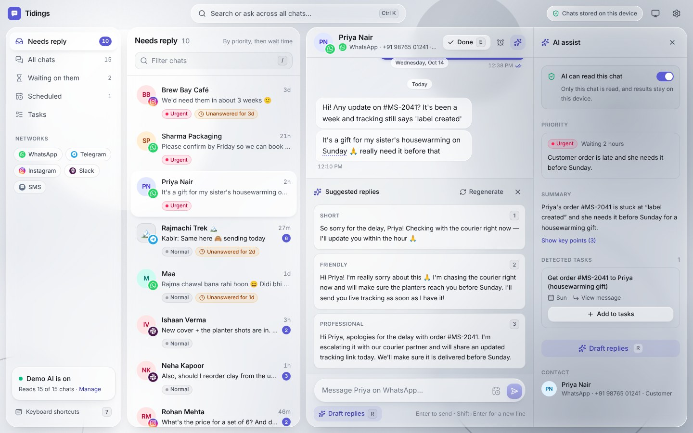
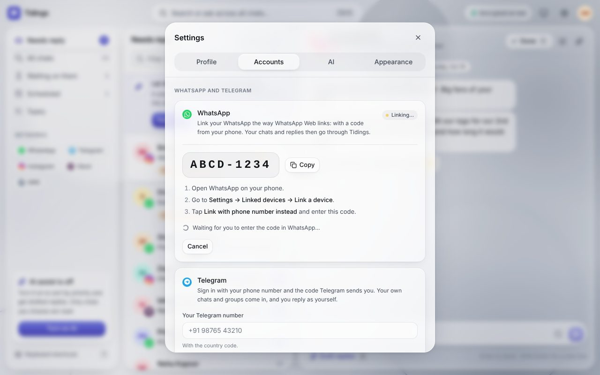
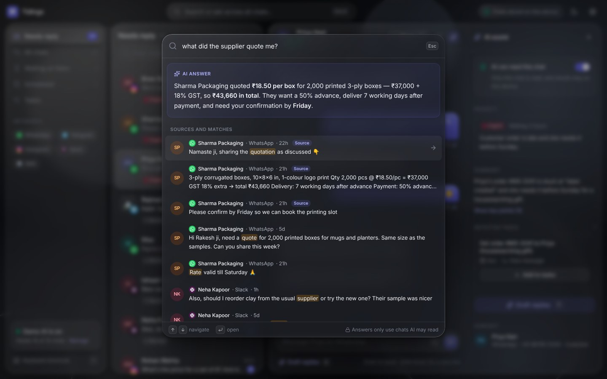

# Sytext — an AI-first unified inbox

People with chats spread across WhatsApp, Telegram, Instagram, Slack and SMS lose track of who is
waiting on them, and replying takes effort. Sytext puts every chat in one place, tells you **who
needs a reply** (sorted by AI priority and how long they've waited) and **drafts the reply** for you.
Nothing is ever sent automatically.

- **Accounts.** Sign in with **Google**, or with an **email and password**.
- **Your own WhatsApp and Telegram.** Link **WhatsApp** by typing the 8-character code Sytext
  shows into *Linked devices* on your phone (or scanning a QR code), the way WhatsApp Web links.
  Link **Telegram** with your phone number and the login code Telegram sends you, or by scanning a
  QR code, plus your two-step password if you use one. Your chats sync to the inbox on every
  device you sign in on, and you reply from Sytext. The links keep running on the server when you
  sign out or close the app.
- **Chats live on your devices, not in the database.** Each browser keeps its own copy; the
  server keeps only the links and the latest 40 messages of each chat (plus any pinned or
  starred), so a small free database is enough.
- **Conversations as on the networks themselves.** Quoted replies, reactions, "typing…" both
  ways, profile and group pictures, read ticks, and earlier messages as you scroll back. Voice
  messages play in the chat. Edit your messages, unsend them or delete messages just for you, pin
  and star messages, search for a word in a chat, and archive chats. The demo chats have all of
  it too.
- **Incognito mode**, as in Beeper: read messages without sending read receipts, and type
  without showing "typing…".
- **More connections from the browser.** A **Telegram bot**, and a **Matrix** account (through
  Matrix bridges: WhatsApp, Instagram, Slack and SMS).
- **Real AI.** Add your **Claude API key** and every AI feature calls Claude. Without one, a
  built-in demo AI runs on the device.
- **Demo inbox.** 15 sample conversations across five networks, generated relative to now, in
  English and Hinglish. Try it without an account, too.

Sytext is a web app plus a small Node server (`server/`) that handles sign-in and keeps the
WhatsApp and Telegram links running. Without the server (say, built as a static site) the app still
works: just the demo, the browser connections and AI, with no accounts.

The interface is clear "liquid glass": nearly untinted, lightly blurred columns with bright specular
edges, floating over a neutral silver (or graphite) backdrop of soft light and a few crisp shapes
that the glass softens as they pass behind it. Light and dark.



## Run it

Requires Node 22.12+ and, for accounts, a MongoDB database (local, or a free MongoDB Atlas cluster).

```bash
npm install
cp .env.example .env    # then fill in MONGODB_URI and JWT_SECRET at least
npm run dev:server      # the API on :5001, restarting on changes
npm run dev             # the app on http://localhost:5173 (forwards /api to the server)
npm test                # unit tests (Vitest); see Tests for the database ones
npm run build           # typecheck, the web app (dist/) and the server (dist-server/)
npm start               # production: the API and the built app on $PORT
npm run lint
```

### Deploy on Render

`render.yaml` describes one **Web Service** that serves both the API and the app. Either create it
from the Blueprint, or make a Web Service by hand with:

| Setting | Value |
| --- | --- |
| Build command | `npm ci --include=dev && npm run build` |
| Start command | `npm start` |
| Health check path | `/api/health` |

Then set the environment variables (**Environment** tab), or put them in a Secret File named
`.env` there (the server reads `.env` from its folder or from `/etc/secrets/`; variables set in the
Environment tab win). `MONGODB_URI` and `JWT_SECRET` are required; `.env.example` explains every
variable. The service's log says which file it read and which features are on:

| Variable | What it does |
| --- | --- |
| `MONGODB_URI` | Your database. Give Sytext one of its own (a name after the host, like `…mongodb.net/sytext?…`), not one another app uses. With MongoDB Atlas, allow connections from Render (Network Access → `0.0.0.0/0`). |
| `JWT_SECRET` | Signs sessions: 32+ random characters (`openssl rand -base64 48`). |
| `DATA_ENCRYPTION_KEY` | Encrypts stored chats and sessions (`openssl rand -base64 32`; the Blueprint generates one). |
| `GOOGLE_CLIENT_ID` | Turns on "Continue with Google". |
| `TELEGRAM_API_ID`, `TELEGRAM_API_HASH` | Turn on linking Telegram accounts. |
| `CLOUDINARY_CLOUD_NAME`, `CLOUDINARY_API_KEY`, `CLOUDINARY_API_SECRET` | Your own profile photo. (Photos and files in chats don't need it.) |
| `KEEP_AWAKE` | `off` stops the server visiting itself to stay awake (see below). `KEEP_AWAKE_URL` sets the address to visit elsewhere than Render. |
| `TEMPORARY_STORAGE` | `off` stops the server keeping accounts in temporary storage while the database can't be reached (see below). |

`PORT` is optional: the server listens where Render tells it to.

Keep these values out of the repository, screenshots and chats. If one has been shared, rotate it:
a new database user password (and `MONGODB_URI`), a new Cloudinary API secret, and a new
`JWT_SECRET` (which signs everyone out).

Things to know about hosting:

- **A database it can't reach doesn't stop anything.** The server starts a private MongoDB of its
  own ("temporary storage") so signing in and linking work anyway, and keeps trying the real one
  every 30 seconds. When it answers, everything made meanwhile moves over (same ids, so sign-ins
  and links carry on) and the server switches without a restart. Until then, anything in
  temporary storage is lost if the server restarts, and the sign-in screen and Settings → Accounts
  say so, with what to fix. With MongoDB Atlas it's usually its IP Access List (allow `0.0.0.0/0`,
  since a host like Render has no fixed address) or a paused cluster. Temporary storage downloads
  MongoDB 7.0 on first use and takes about 150 MB of memory; `TEMPORARY_STORAGE=off` makes the
  server wait for the database instead, serving the app without accounts meanwhile.

- **Run one instance.** Each WhatsApp and Telegram link lives in the server process, and WhatsApp
  allows one connection per linked device.
- **Free instances sleep** after 15 minutes without visits, and a sleeping server can't hold the
  WhatsApp and Telegram connections. So while any account is linked, the server visits its own
  address (`RENDER_EXTERNAL_URL`, which Render sets) every 10 minutes to stay awake. One service
  running all month fits in Render's 750 free instance hours, but not two. Set `KEEP_AWAKE=off` to
  let it sleep: when it wakes, it reconnects and catches up (Telegram fetches what's new in your
  recent chats, and WhatsApp delivers what it held for the linked device).
- **Links look after themselves.** Every 5 minutes the server reconnects any linked account that
  isn't connected (a dropped connection, a failed reconnect, a restart), and every 10 minutes it
  checks Telegram for messages it missed while the connection was down.

**Try this:** click **Turn on AI** · press `J`/`K` to move through the queue · `R` for drafts,
`1`–`3` to pick one, edit, `Enter` to send · `E` to mark done · `⌘K`/`Ctrl+K` and ask *"what are
my tasks for today?"*, *"have I ordered anything?"* or *"when is my flight?"* · then open
**Settings** to connect your own accounts and a Claude key. Questions about tasks are answered from
your open tasks (with their due dates) as well as your chats.

| Key | Action | Key | Action |
| --- | --- | --- | --- |
| `J` / `K` | Next / previous chat | `E` | Mark done |
| `Enter` | Reply (focus composer) | `S` | Snooze |
| `R` | Draft replies | `A` | Toggle AI panel |
| `1` `2` `3` | Use a draft | `⌘K` / `Ctrl+K` | Search & ask across chats |
| `Tab` | Next `[blank]` in a draft | `/` · `?` · `Esc` | Filter list · Help · Close |

## Sign in

The first screen offers **Continue with Google**, email and password, or the demo without an
account.

- **Sessions** are a signed token in an `httpOnly`, `SameSite=Lax` cookie (secure in production),
  valid for 30 days. Every change to the server must be sent as JSON, which a page on another site
  can't do without the server's permission, so the cookie can't be used from elsewhere (CSRF).
- **Passwords** are hashed with scrypt. Sign-in attempts are rate-limited per IP address.
- **Recovery keys** stand in for a reset email, which Sytext doesn't send. Creating an account
  shows a key once, like `7K2QP-M9XHD-4T8RW-CZ6NB-J3VFA` (125 random bits), to copy or download.
  If the password is forgotten, **Forgot password?** on the sign-in screen takes the email, the
  key and a new password. The key then stops working and a new one is shown, and the account's
  other sessions end. Only a SHA-256 hash of the key is stored. Resets are rate-limited more tightly
  than sign-ins. **Settings → Profile** makes a new key with the current password, for accounts
  made before keys existed or a lost key. Changing the password gives a new key too (the old one
  stops working: someone who knew the old password could have made it). Linking Google to an
  account with the same email removes its key, for the same reason it turns the password off.
- **Google**: the ID token from Google's button is verified on the server (signature, issuer,
  audience, expiry, verified email). Signing in with Google to an existing account with the same
  email links the two, and turns that account's password off and ends its sessions, since email
  addresses aren't verified on sign-up and whoever set the password may not own the address. The
  user can then set a new password under **Settings → Profile**.

To turn on Google sign-in, create an OAuth client id of type *Web application* in the
[Google Cloud console](https://console.cloud.google.com/apis/credentials), add your site's address
(and `http://localhost:5173`) under *Authorized JavaScript origins*, and set `GOOGLE_CLIENT_ID`.

**Settings → Profile** changes your name, photo (with Cloudinary set up), password and recovery key,
and signs out.

## Link WhatsApp and Telegram

In **Settings → Accounts** (or the account menu → *WhatsApp and Telegram*), once signed in.

### WhatsApp

Enter your number and Sytext shows an 8-character code. On your phone, open WhatsApp →
**Settings → Linked devices → Link a device → Link with phone number instead**, and type it in. Or
choose **QR code** and scan it from the same screen. Sytext becomes one of your linked devices,
like WhatsApp Web; your phone doesn't have to stay online.



- It brings in your recent chats (up to 40 messages each) and every new message after that, with
  delivery and read ticks for yours, edits and deletions.
- **Photos and files** both ways: photos show in the chat, videos and documents as cards, and
  each one downloads (see *Photos and files* below). Stickers show as stickers, animated ones
  too, and voice messages play in the chat (see below). The paperclip, pasting, or dropping files on
  the message box sends them; JPEG and PNG go as photos, MP4 as video, anything else as a document.
- Quoted replies and reactions come in and go out, also those on messages from history. You see
  when someone is typing, and they see when you are. Profile and group pictures show too.
- Scrolling back past what's stored asks your phone for older messages, as WhatsApp Web does.
  They arrive a moment later, if the phone is online.
- Reading a chat in Sytext marks it read on WhatsApp; replies go out from your number.
- **Unlink** logs the device out (it disappears from *Linked devices*) and deletes its chats from
  the server. If you remove the device from your phone instead, syncing stops and Settings offers
  to link again or remove its chats.
- It uses [Baileys](https://github.com/WhiskeySockets/Baileys), an unofficial WhatsApp Web client.
  WhatsApp doesn't support third-party clients and can restrict numbers that use them; the app
  says so before linking.

### Telegram

Enter your number; Telegram sends a login code to your Telegram app (or by SMS). Enter it, and your
two-step verification password if you have one. Or choose **QR code** and scan it in Telegram on
your phone (**Settings → Devices → Link Desktop Device**). Sytext signs in as you, like Telegram on
a new device, and shows up in Telegram under **Settings → Devices**, where you can end it.

- Your 30 most recent chats come in (20 messages each; broadcast channels are left out), then
  everything new, with read status both ways, edits, and photos, files, stickers and voice
  messages as above.
- Quoted replies, reactions (Telegram's standard set), typing both ways, and profile and group
  pictures. Scrolling back fetches earlier messages from Telegram.
- **Unlink** ends the session in Telegram and deletes its chats from the server.
- The server needs an `api_id` and `api_hash` for the deployment from
  [my.telegram.org](https://my.telegram.org) → *API development tools*. It uses
  [GramJS](https://gram.js.org), a client for Telegram's own API (MTProto).

### Photos and files

Nothing is uploaded anywhere else, and nothing is stored on the server:

- **Received** photos, videos and documents get a private link on your Sytext server. Opening it
  (or the photo showing in the chat) fetches the file from WhatsApp or Telegram right then and
  streams it to the browser, which caches it. The link carries, encrypted, what the network needs
  to find the file again, so it keeps working for messages the server no longer keeps.
- **Sending:** the browser hands the file to the server, which passes it straight on to WhatsApp or
  Telegram (they keep it). Up to 50 MB each, ten at a time, sent one after another in the order
  picked; the message text becomes the first one's caption (text longer than a caption's 1,024
  characters goes as its own message first). JPEG and PNG go as photos; anything else, WebP
  included, as a file. A photo that couldn't be fetched (the network reconnecting, say) offers
  **Try again**.
- **Safety:** a link works only for the account it belongs to. Only plain images, video and audio
  are shown in the page; anything else (say, an HTML file someone sent) is always a download, and
  is served with a sandboxing policy, so it can't run as part of the site.
- WhatsApp keeps media on its servers for a while, then asks your phone to upload it again when
  it's opened. If the phone no longer has it, Sytext says it's no longer available. Opening a file
  needs the account connected.
- **Stickers** show on their own, without a bubble: WebP images, Telegram's WebM video stickers,
  and animated Lottie stickers (Telegram's .tgs, WhatsApp's animated ones), which the app plays
  with lottie-web's light build. It runs nothing from the file, fetches no pictures or fonts from
  elsewhere, and stops unpacking a sticker once it passes 8 MB. Animated and video stickers load
  as they scroll into view, and only play while they're on screen.
- **Voice messages** play in the chat: a play button, the waveform WhatsApp or Telegram sends
  with it (tap or drag it to jump), how long it is, and 1× / 1.5× / 2× speed. One plays at a
  time. Audio files (music, recordings) play the same way, with their name and a download link.
  A voice message is fetched whole the first time it's played (they're small), so it can be
  scrubbed at once. Browsers that can't play WhatsApp's Ogg Opus offer it as a download instead.
- **Kept before this existed?** Stickers, voice messages, photos and files kept by earlier
  versions had no link (a sticker or voice message was only named). When the server reconnects
  (at most hourly), it asks again for the latest 40 of them: WhatsApp's phone sends each one again
  (it must be online), and Telegram is asked by message id. They then open like new ones; any
  that don't come are asked for again a day later. One deleted or edited since stays that way.

### Edit, delete, pin, star and search

Each message's **⋯** menu (hover, or tap the message on a phone) has what its network allows:

- **Edit** one of your messages: it goes back into the message box; `Enter` saves, `Esc` cancels.
  It changes for everyone and shows *edited*, as edits made on the phone do. WhatsApp allows 15
  minutes after sending, Telegram 48 hours; past that Sytext says so and keeps your new text.
- **Delete for everyone** (your own messages) leaves *You deleted this message*, as WhatsApp
  does; when someone else unsends one, it shows *This message was deleted*. WhatsApp allows about
  2 days. On Telegram the message just disappears, as it does there.
- **Delete for me** removes it from Sytext and, on WhatsApp, from your phone too. Telegram's
  large groups and channels have no "delete for me" (deleting there deletes for everyone), so
  there it's removed from Sytext only.
- **Pin** pins it in the chat for everyone (on WhatsApp for 30 days, the longest it offers). The
  chat's pinned messages show in a bar above it; tapping it jumps to each in turn. WhatsApp pins
  run out after the time they were pinned for (24 hours, 7 days or 30 days), and leave the bar then
  too. Pinning or starring an old message keeps it on the server however old, so it shows on every
  device.
- **Star** keeps it under **Starred** in the sidebar, from every chat, newest first. On WhatsApp
  it's starred on your phone too; Telegram has no stars, so they're kept by Sytext.
- **Copy text.**

Edits, deletions and pins made in WhatsApp or Telegram themselves show in Sytext too, and so do
stars from your phone's WhatsApp.

**Search in a chat** with the 🔍 in its header: every match is highlighted, and `Enter` /
`Shift+Enter` (or the arrows) go to the older or newer one. It searches the messages loaded in
the chat; **Earlier** loads older ones until it finds more. Deleted messages aren't searched.

### Archive

**Archive chat**, in a chat's **⋯** menu, takes it out of Needs reply, All chats and Waiting on
them, into **Archived** in the sidebar (its count is archived chats with something unread).
**Unarchive chat** brings it back; the toast offers Undo too.

- **WhatsApp and Telegram** chats are archived on the network itself, so your phone shows them
  archived too, and archiving or unarchiving on the phone shows in Sytext. Whether a new message
  brings a chat back is up to the network: WhatsApp keeps it archived while *Keep chats archived*
  is on in its settings; Telegram brings back chats that aren't muted.
- Other chats (a Telegram bot, Matrix, the demo) are archived in Sytext, on that device.

### Incognito mode

**Settings → Privacy → Incognito mode**, as in Beeper. While it's on, an **Incognito** badge shows
at the top:

- **No read receipts.** Opening a chat clears its unread count in Sytext, but WhatsApp's blue
  ticks and Telegram's "seen" don't go out (Matrix gets a private read receipt). It stays read in
  Sytext even though WhatsApp and Telegram still count it unread. To let one chat know, choose
  **Mark as read for them** in its ⋯ menu (it says so if that can't go out right now).
- **No "typing…"** while you write.
- Signed in, it's a setting of your account: every device follows it at once, and the server
  itself won't send read receipts or typing for you, whatever an older copy of the app asks.
  Without an account it applies on that device.
- Replying still shows you were there, of course, and opening the chat on your phone may send
  read receipts from the phone.

### Where your chats are kept

- **On the server:** the linked sessions (they have to run somewhere when no browser is open, and
  WhatsApp can't run inside a web page), your chats and contacts, and only the **latest 40
  messages of each chat**, to pass on to your devices, and pinned or starred messages however old.
  Older messages are deleted from the server every minute; data from before this limit is trimmed on start. Profile pictures aren't stored:
  only that one exists, and the image is kept in memory and fetched again from WhatsApp or
  Telegram when needed. So the database stays small however much you chat: about chats × 40
  messages, plus the session keys.
- **On each device:** everything that browser has seen, in its own storage (IndexedDB). It shows
  straight away when you open the app, even offline, and scrolling back reads it before asking
  the network. Further back, older messages come from Telegram, or from your phone for WhatsApp.
  If more came in while a device was away than the server keeps, the device fetches the gap.
  Messages deleted for you elsewhere go from it too; the server remembers those for a month (50
  per chat), so a device away longer starts those chats afresh from the server's copy.
  **Settings → Accounts** shows how much space it uses.
- **Signing out** deletes the copy on that device (and closing the app with an expired session
  does on the next start). The links keep running on the server: messages keep coming in, and
  they're there when you sign in again. To stop them, **unlink**.

On the server, session keys, chat and contact names, message text and attachments are **encrypted
at rest** (AES-256-GCM, with `DATA_ENCRYPTION_KEY`), so a copy of the database alone reveals no
chats. Ids, times, counts and whether a message is pinned or starred stay readable so the
database can sort and keep them. Done/snoozed state, tasks
and AI results stay in the browser, as for every other source.

## More connections, from the browser

Also in **Settings → Accounts**. These talk to their networks directly from your browser, without
the server, and keep their messages in this browser's storage. Tokens are stored there too, so use
a browser profile you trust; **Disconnect** deletes an account's token and chats from the device.

### Telegram bot

Customers or friends message your bot (or a group it's in) and you answer as the bot. This uses the
Telegram Bot API, not your personal account; for that, use Matrix with the Telegram bridge.

1. In Telegram, message [@BotFather](https://t.me/BotFather), send `/newbot` and copy the token.
2. To read group chats, also send `/setprivacy` → your bot → **Disable**.
3. Paste the token in **Settings → Accounts → Telegram bot**. It's checked with Telegram first.

Bots can't fetch chat history, only new messages, which Telegram keeps for 24 hours. So chats
start from the moment the bot is connected, and messages that arrive while Sytext is closed are
picked up when it opens. Only one browser tab polls Telegram (it allows a single reader per bot);
other tabs follow along. If the bot already delivers to a webhook, Settings offers to switch it
over. You can also point it at a self-hosted `telegram-bot-api` server.

### Matrix, and WhatsApp, Instagram, Slack and SMS through bridges

Sign in to any Matrix homeserver with a password, or paste an access token from another Matrix app
(needed for servers that only allow single sign-on). Every joined room becomes a chat.

Rooms created by [mautrix](https://docs.mau.fi/bridges/) bridges announce what they bridge (an
`m.bridge` state event), so a WhatsApp chat appears under **WhatsApp**, shows the contact's phone
number, and replies go out on WhatsApp. This covers mautrix-whatsapp, -meta (Instagram), -slack,
-gmessages (SMS/RCS) and -telegram. Run the bridges on your own homeserver; most bridges require
that, and it keeps your chats on infrastructure you control.

- The homeserver must allow requests from the site (CORS). Synapse does by default.
- **End-to-end encryption isn't supported yet.** Messages in encrypted rooms show as locked, and
  replying there is refused with an explanation. Bridges can be configured to keep portal rooms
  unencrypted (the `encryption` section of their config).
- Disconnecting signs out the session Sytext created. A pasted access token belongs to another
  app, so that session is left alone.

### The demo inbox

The sample conversations are for trying Sytext without an account. **Settings → Accounts → Demo
chats** shows or hides them, and while they're shown you can simulate an incoming message or reset
them. Once you're signed in they never show: your inbox is only your own chats (the setting is
kept for when you sign out).

## AI with Claude

Add a key in **Settings → AI** (create one in the [Claude Console](https://platform.claude.com/settings/keys)).
It is checked with Anthropic, stored only in this browser, and sent only to `api.anthropic.com`.

| Feature | Model (default) | Effort |
| --- | --- | --- |
| Sorting the queue: priority, and whether a reply is expected | Claude Haiku 5.5 | low |
| Summaries and detected tasks | Claude Opus 5.5 | low |
| Drafts (all three tones in one request) and answers in ⌘K | Claude Opus 5.5 | medium |

Both models can be changed in Settings. Sorting gets the fast model by default because it runs
for every allowed chat whenever that chat changes.

How it's called (`src/ai/llm.ts`, `src/ai/claude.ts`):

- **SDK.** The official `@anthropic-ai/sdk`, from the browser
  (`dangerouslyAllowBrowser`). That's appropriate here because it's your own key on your own
  device. A hosted, multi-user deployment should proxy requests through a backend instead.
- **Structured output.** Every request asks for it, with zod schemas, so results arrive already
  parsed. Ids and dates the model returns are checked against the chat before they're used.
- **Server-side fallbacks are on** (`fallbacks: "default"`, beta `server-side-fallback-2026-07-01`).
  If a model declines a request on policy grounds, the API retries it on a fallback model in the
  same call. Haiku 5.5 has no fallback, so a declined request there simply fails. A final
  `stop_reason: "refusal"` is shown as such.
- **Limits.** At most three requests run at once, and interactive ones (drafts, answers, the open
  chat) go ahead of background sorting.
- **Errors.** A rejected key or unavailable model pauses automatic calls and says so. Other errors
  show their reason next to the result, with a retry.

Results are cached per chat, keyed on its latest message, so Claude only runs again when a chat
changes. Without a key, the same functions use the built-in demo AI (`src/ai/mock/`): canned
results for the demo chats and simple rules elsewhere.

**Privacy.** AI is off until you allow it, and then only for the chats you select (**Settings →
AI**, or a single chat from its AI panel). New chats stay unselected until you allow them. The gate
lives inside the AI module (`src/ai/access.ts`), not just the UI, so an unselected chat can't reach
a model even by accident. With a Claude key, the allowed chats are sent to Anthropic when a feature
needs them. Turning AI off clears AI results from the device.



## How it's built

React 19 + TypeScript + Vite, Tailwind CSS v4, Zustand, Motion.

```
src/
  data/
    api.ts            ← the only data-access module: InboxApi + ConnectionsApi
    unified/          ← merges every source; routes by id prefix; done/snoozed, tasks and
                        scheduled sends for real accounts, kept on the device
    connectors/
      telegram/       ← Bot API client and connector (long polling, local message store)
      matrix/         ← matrix-js-sdk connector, loaded on demand; bridge detection
    mock/             ← the demo inbox: seed data and a localStorage "server"
    search.ts         ← keyword search used for every source
  ai/
    index.ts          ← draftReply, summarizeThread, classifyPriority, extractTasks, answerQuestion
    access.ts         ← privacy gate every AI function checks
    llm.ts            ← Claude config, request limiter, errors
    claude.ts         ← Claude calls: schemas, structured output, fallbacks (loaded on demand)
    prompts.ts        ← the prompt for each function
    mock/             ← the built-in demo AI
  store/              ← Zustand stores (inbox cache, AI results, connections, UI, settings) and actions
  components/         ← layout, thread list, conversation, AI panel, command bar, settings…
```

Data flows one way: **components → stores → `api` / `ai`**. Components never import a source
directly. The inbox store only caches what `api` returns: the initial load, its own writes, and
the events every source pushes.

The "Needs reply" queue is derived (`store/selectors.ts`). A chat is in it when:
- the other person wrote last;
- it expects a response (AI decides when allowed, simple on-device rules otherwise);
- their last message is from the past week: after 7 days without a reply it's let go, badge and
  all (`NEEDS_REPLY_FOR` in `src/config.ts`), and comes back when they write again (a chat snoozed
  for longer gets its week from when the snooze ends);
- it isn't done, snoozed or scheduled.

Ids carry their source (`wa:…` and `tga:…` from the server, `tg:…`, `mx:…`, none for demo chats),
so writes route without lookups. To add a network, implement `Connector`
(`src/data/connectors/types.ts`) and register it in `src/data/unified/unifiedApi.ts`.

The server (Express 5, MongoDB, TypeScript run by `tsx` in development and bundled by Vite for
production):

```
server/
  index.ts            ← reads the environment, serves, connects (waiting as long as it takes)
  temporaryDatabase.ts ← a private MongoDB for while MONGODB_URI can't be reached
  holding.ts          ← what's served while there's no database at all: the app, and why accounts are off
  app.ts              ← the HTTP app: security headers, JSON-only API, the built web app
  config.ts           ← environment variables; what's required, what turns features on
  auth/               ← sign-up, sign-in, Google ID tokens, scrypt passwords, session tokens
  networks/
    whatsapp.ts       ← Baileys: pairing code / QR, sessions in MongoDB, history, live sync
    telegram.ts       ← GramJS: phone + code + 2FA, sessions, dialogs, live sync
    accounts.ts       ← linked accounts and their status
    routes.ts         ← /api/link/…
  inbox/              ← per-user chat store (encrypted fields) and /api/inbox, /api/threads/…
  realtime.ts         ← server-sent events (/api/events) to the user's open tabs
  crypto.ts           ← AES-256-GCM for data at rest
```

In the browser, `src/data/server/` is the client: `serverApi.ts` for HTTP; `deviceStore.ts`, this
device's copy of the chats in IndexedDB; and `ServerConnector`, which shows that copy, loads
`/api/inbox` and merges it in, then follows `/api/events`, reloading whenever the stream
reconnects so nothing is missed. The wire types (`src/data/server/types.ts`) are shared by both
sides.

The Matrix SDK (~900 kB) and the Claude SDK are separate chunks, downloaded only once Matrix is
connected or a key is saved.

### Tests

- **Unit tests (`npm test`)** cover the demo data, search, selectors and reply rules, and the demo AI.
- **Server.** Sealing, passwords, session tokens, Google ID tokens (against a local key set),
  config, and mapping Telegram's objects. With `TEST_MONGODB_URI` set (any MongoDB; each run uses
  and drops its own database), integration tests run the whole API against fake WhatsApp and
  Telegram transports: sign-up and sign-in, Google account linking, CSRF and forged cookies,
  linking both networks step by step (Telegram by code and by QR), history, live messages,
  edits, read receipts, sending, quoted replies, reactions, typing, profile pictures, earlier
  messages, restarts, ended sessions, unlinking, that stored text is encrypted, trimming to the
  latest 40 messages, acting on messages only a device still has, Telegram catching up on missed
  messages, and links carrying on through signing out and back in.

  ```bash
  TEST_MONGODB_URI=mongodb://127.0.0.1:27017 npm test
  ```
- **Server connector and device copy.** Loading, live events, routing sends, reactions, typing,
  earlier messages and read markers, holding back the echo of a message being sent; the copy on
  the device (against an in-memory IndexedDB): shown before the server answers, kept when the
  server lets go, paged back through first, gaps filled, unlinked networks dropped, and deleted
  on sign-out.
- **In a browser.** `server/testing/e2e.ts` runs the app against the same fakes, with a control
  port standing in for the phone, for clicking through linking end to end.
- **Claude requests.** A stubbed `fetch` checks the request shape (model, effort, structured
  output, fallbacks, no sampling parameters), refusals and error mapping.
- **Telegram connector.** Tested against an in-memory Bot API.
- **Unified inbox.** Merging, routing, local done/snooze state, scheduled sends, search and
  disconnecting.

The connectors were also run end-to-end in a browser against a local Synapse homeserver (with a
simulated WhatsApp bridge room) and a local Telegram Bot API server.

## Limits and next steps

- **One server instance**, and linked accounts sync only while it runs (see Deploy).
- **Changes to old messages.** An edit, deletion, pin or reaction made on the phone to a message
  the server no longer keeps (older than the latest 40 of its chat, and not pinned or starred)
  isn't passed on to devices.

- **Encryption.** Matrix end-to-end encrypted rooms (matrix-js-sdk's Rust crypto plus device
  verification).
- **History.** Linked WhatsApp and Telegram chats load earlier messages as you scroll back. Matrix
  rooms show their last 30 messages, and a Telegram bot only what it has seen.
- **Scheduled sends** go out while Sytext is open. One that was due while it was closed waits for
  you instead of arriving hours late. Matrix delayed events (MSC4140) would let the server send them.
- **Sync across devices.** Done, snoozed and tasks live on one device. For Matrix they could sync
  through room account data.
- **One person, one chat.** The same person on several networks isn't merged yet.
- **Notifications.** No push notifications.
